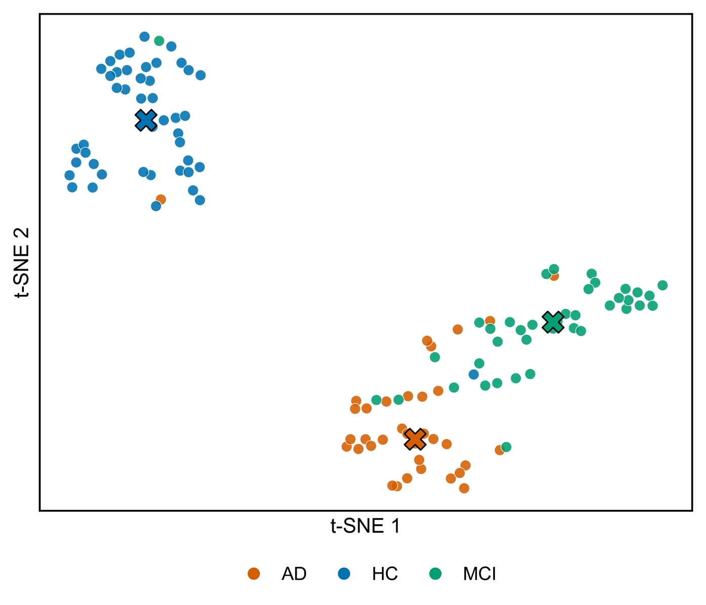
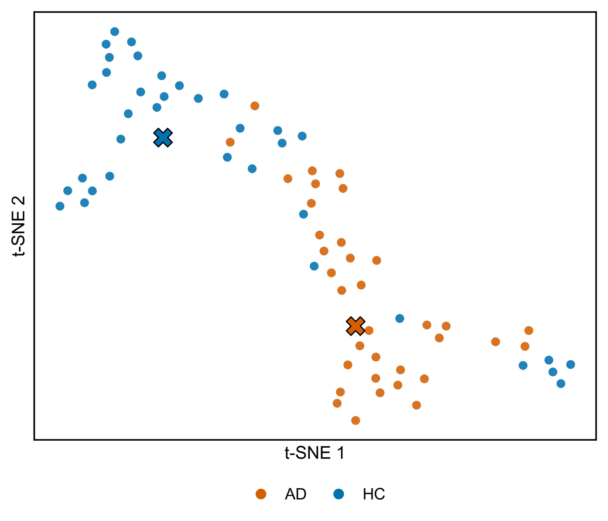

# t-SNE Visualizations for NCMMSC and ADReSSo

Additional t-SNE visualizations of learned representations, retained from the original manuscript figures.

## (a) NCMMSC

## (b) ADReSSo

To visualize the distribution of the learned representations, we used t-SNE to project the final representations of test samples into two dimensions, as shown in Fig. 6. On NCMMSC, most HC samples formed a relatively compact cluster that was clearly separated from AD and MCI. AD and MCI samples also showed a tendency to cluster in different regions, with some mixing where the two groups met. On ADReSSo, AD and CN samples mainly occupied different regions, although several samples were interspersed between the groups. Taken together, both visualizations showed class-related grouping, providing qualitative support for the discriminative value of the learned representations.
